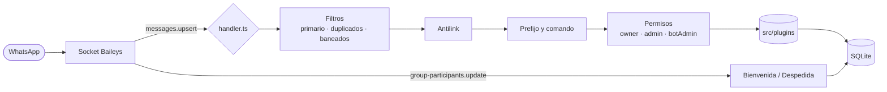

<div align="center">


<a href="https://github.com/Abrahan987/Yae-Miku-Bot">
  
</a>

<br/>


[**Instalar**](#-instalación) · [**Cómo funciona**](#-cómo-funciona) · [**Comandos**](#-comandos) · [**Crear un plugin**](#-crear-un-plugin) · [**Problemas comunes**](#-problemas-comunes)

</div>

<br/>

Yae Miku es un bot de WhatsApp hecho sobre Baileys, sin frameworks encima y con la base de datos integrada en Node. Un proceso, una carpeta de plugins y un archivo de configuración. Lo que se agrega a `src/plugins/` aparece como comando al guardar, sin reiniciar.

<br/>

## ✦ Lo que trae

| | |
|---|---|
| **Plugins en caliente** | Cada archivo de `src/plugins/` es un comando. Se recargan al guardar. |
| **Sub-bots** | Cualquiera puede vincular su propio número con `.qr` o `.code`. Comparten plugins y base de datos, cada uno con su sesión. |
| **Bot primario por grupo** | Si hay varios bots en un grupo, `.setprimary` decide cuál responde. Los demás se quedan callados. |
| **Resolución LID ↔ número** | Los permisos, warns y estadísticas funcionan aunque WhatsApp entregue el usuario como `@lid`. |
| **Moderación** | Warns con límite configurable, antilink, kick, promote, demote, hidetag y tagall. |
| **Economía** | Yenes, trabajo, apuestas, robos, banco, matrimonios y ranking. |
| **Bienvenida y despedida** | Mensaje propio por grupo con `@user`, `@group` y `@members`. |
| **Descargas y utilidades** | YouTube, TikTok, Instagram, Facebook, Pinterest, stickers, mejora de imagen, traducción e IA. |
| **Reportes al owner** | `.report` envía el mensaje por privado al owner, con antispam. |

<br/>

## ⚡ Instalación

**Requisitos:** Node.js **22.5 o superior** (usa `node:sqlite`) y `ffmpeg` para stickers y mejora de imagen.

<details open>
<summary><b>🐧 Linux (Ubuntu / Debian)</b></summary>

```bash
sudo apt update && sudo apt install -y git ffmpeg curl
curl -fsSL https://deb.nodesource.com/setup_22.x | sudo -E bash -
sudo apt install -y nodejs

git clone https://github.com/Abrahan987/Yae-Miku-Bot.git
cd Yae-Miku-Bot
npm install
npm start
```

</details>

<details>
<summary><b>📱 Termux (Android)</b></summary>

```bash
pkg update && pkg upgrade -y
pkg install -y git nodejs ffmpeg

git clone https://github.com/Abrahan987/Yae-Miku-Bot.git
cd Yae-Miku-Bot
npm install
npm start
```

</details>

<details>
<summary><b>🪟 Windows</b></summary>

```powershell
winget install OpenJS.NodeJS.LTS
winget install Gyan.FFmpeg
winget install Git.Git

git clone https://github.com/Abrahan987/Yae-Miku-Bot.git
cd Yae-Miku-Bot
npm install
npm start
```

</details>

### Vincular WhatsApp

Al arrancar por primera vez el bot pregunta cómo querés entrar. También podés saltarte la pregunta con una bandera:

```bash
npm start              # te deja elegir
npm start -- --qr      # QR en la terminal
npm start -- --code    # código de 8 dígitos
```

Con el código: WhatsApp → *Dispositivos vinculados* → *Vincular con el número de teléfono*.

### Dejarlo corriendo 24/7

```bash
npm i -g pm2
pm2 start npm --name yae-miku -- start
pm2 save
pm2 logs yae-miku
```

### Configuración

Todo está en `config.ts` y se recarga solo al guardarlo:

```ts
global.owner   = '573237649689';
global.namebot = 'Yae Miku Bot';
global.prefix  = ['.', '#'];
global.banner  = 'https://...';
global.icono   = 'https://...';
```

<br/>

## 🧠 Cómo funciona



1. **`index.ts`** abre la base de datos, carga los plugins, arranca el socket y reconecta solo si se cae. Si WhatsApp desvincula el dispositivo, limpia la sesión.
2. **`handler.ts`** recibe cada mensaje, descarta duplicados y los de bots no primarios, cuenta la actividad del grupo, aplica antilink, detecta el prefijo y verifica permisos antes de ejecutar el plugin.
3. **`src/lib/loader.ts`** mantiene un mapa `comando → función` y lo refresca cuando cambia un archivo.
4. **`src/lib/database.ts`** guarda todo en un único `database.sqlite` en modo WAL.

### Usuarios, LID y JID

WhatsApp ahora entrega a muchos usuarios como `algo@lid` en lugar de `numero@s.whatsapp.net`. Yae lo resuelve en capas: primero una caché en memoria, luego el mapeo interno de Baileys y por último el archivo de mapeo de la sesión. Para saber quién es admin, junta `id`, `lid` y `phoneNumber` de cada participante y compara por número.

### Dónde se guarda cada cosa

| Qué | Dónde |
|---|---|
| Sesión del bot principal | `sessions/` |
| Sesiones de sub-bots | `subs/<número>/` |
| Usuarios, yenes, baneos | tabla `users` |
| Advertencias | tabla `warnings` |
| Mensajes por usuario y grupo | tabla `message_stats` |
| Cooldowns de economía y reportes | tabla `economy_cooldowns` |
| Bot primario por grupo | tabla `group_primary` |
| Antilink por grupo | tabla `group_antilink` |
| Bienvenida y despedida | tabla `group_welcome` |
| Matrimonios | tabla `marriages` |
| Contador global de comandos | tabla `bot_stats` |

<br/>

## 📖 Comandos

Prefijos por defecto: `.` y `#`. Con `.menu` el bot muestra la lista completa.

<details>
<summary><b>🛡️ Administración</b></summary>

| Comando | Qué hace |
|---|---|
| `warn` · `advertir` · `aviso` | Advierte a un usuario |
| `unwarn` · `delwarn` · `resetwarn` · `checkwarn` | Gestiona advertencias |
| `setwarnlimit` | Cantidad de warns antes de expulsar |
| `kick` · `kickall` | Expulsa |
| `promote` · `demote` | Da o quita admin |
| `antilink` | Borra links, y expulsa si es un link de WhatsApp |
| `hidetag` · `tagall` | Menciones |
| `open` · `close` | Abre o cierra el grupo |
| `link` · `revoke` | Enlace del grupo y reinicio del enlace |
| `setgpname` · `setgpdesc` · `setgpbanner` | Edita el grupo |
| `setprimary` · `resetprimary` | Bot primario del grupo |
| `topcount` · `topinactive` · `count` | Actividad de los miembros |

</details>

<details>
<summary><b>👋 Bienvenida y despedida</b></summary>

| Comando | Qué hace |
|---|---|
| `welcome on/off` | Activa o desactiva la bienvenida |
| `goodbye on/off` | Activa o desactiva la despedida |
| `setwelcome <texto>` | Mensaje propio, `clear` para borrarlo |
| `setgoodbye <texto>` | Igual, para la despedida |

Variables: `@user`, `@group`, `@members`.

```text
.setwelcome Hola @user, bienvenido a @group. Ya somos @members.
```

</details>

<details>
<summary><b>💰 Economía</b></summary>

| Comando | Qué hace |
|---|---|
| `balance` · `perfil` | Saldo y perfil |
| `daily` · `work` | Ingresos con cooldown |
| `bet` | Apostar yenes |
| `steal` | Robar a otro usuario |
| `deposit` · `withdraw` | Banco |
| `marry` · `divorce` | Matrimonios |
| `rank` | Ranking |

</details>

<details>
<summary><b>📥 Descargas</b></summary>

| Comando | Fuente |
|---|---|
| `play` · `mp3` | YouTube, audio |
| `play2` · `mp4` | YouTube, video |
| `tiktok` · `tiktoksearch` | TikTok |
| `instagram` · `facebook` · `pinterest` | Redes |

</details>

<details>
<summary><b>🧰 Utilidades</b></summary>

| Comando | Qué hace |
|---|---|
| `sticker` · `toimg` · `tourl` | Stickers y conversiones |
| `hd` · `enhance` · `remini` | Mejora de imagen |
| `ia` · `chatgpt` | Chat con IA |
| `translate` | Traductor |
| `emojimix` | Mezcla de emojis |
| `userinfo` · `get` · `getpic` · `read` · `say` · `gitclone` | Herramientas varias |
| `report` · `reportar` · `error` | Envía un reporte al owner |

</details>

<details>
<summary><b>🤖 Sub-bots y owner</b></summary>

| Comando | Qué hace |
|---|---|
| `qr` · `code` | Vincula tu propio número como sub-bot |
| `bots` · `sockets` | Lista de bots activos |
| `setusername` · `setpfp` · `setbanner` · `seticon` · `setowner` … | Personaliza el sub-bot |
| `setprefix` · `setname` · `setstatus` · `join` · `leave` | Solo owner |

</details>

<br/>

## 🧩 Crear un plugin

Creá `src/plugins/hola.ts`, guardalo y ya existe el comando. No hay que registrar nada.

```ts
export const command = ['hola', 'hi'];
export const category = 'utils';
export const description = 'Saluda al usuario.';
export const admin = false;
export const botAdmin = false;
export const owner = false;

export default async function (sock: any, msg: any, extra: any, db: any) {
    await msg.reply(`Hola ${msg.pushName}`);
}
```

| Parámetro | Contenido |
|---|---|
| `sock` | Socket de Baileys |
| `msg` | Mensaje ya serializado: `from`, `sender`, `body`, `quoted`, `mentionedJid`, `isGroup`, `reply()` |
| `extra` | `command`, `args`, `text` |
| `db` | Helpers ya ligados al usuario que escribe |

`admin`, `botAdmin` y `owner` hacen que el handler valide el permiso antes de ejecutar nada.

<br/>

## 🩹 Problemas comunes

<details>
<summary><b>No encuentra el módulo <code>node:sqlite</code></b></summary>

Tu Node es menor a 22.5. Revisá con `node -v` y actualizá a la versión 22 LTS.

</details>

<details>
<summary><b>Los stickers o el comando <code>hd</code> fallan</b></summary>

Falta `ffmpeg`. Comprobalo con `ffmpeg -version`.

</details>

<details>
<summary><b>El bot se desvinculó o no conecta</b></summary>

Cerrá el proceso, borrá la carpeta `sessions/` y volvé a ejecutar `npm start` para vincular de nuevo.

</details>

<details>
<summary><b>Un comando nuevo no aparece</b></summary>

Revisá que el archivo exporte `command` como arreglo y tenga un `export default` con la función. Si tiene un error de sintaxis, la consola lo muestra al recargar.

</details>

<br/>

## 📜 Licencia y créditos

Hecho por **Abrahan** · Licencia [MIT](LICENSE).

Construido sobre [Baileys](https://github.com/WhiskeySockets/Baileys).

<div align="center">

<br/>


</div>
